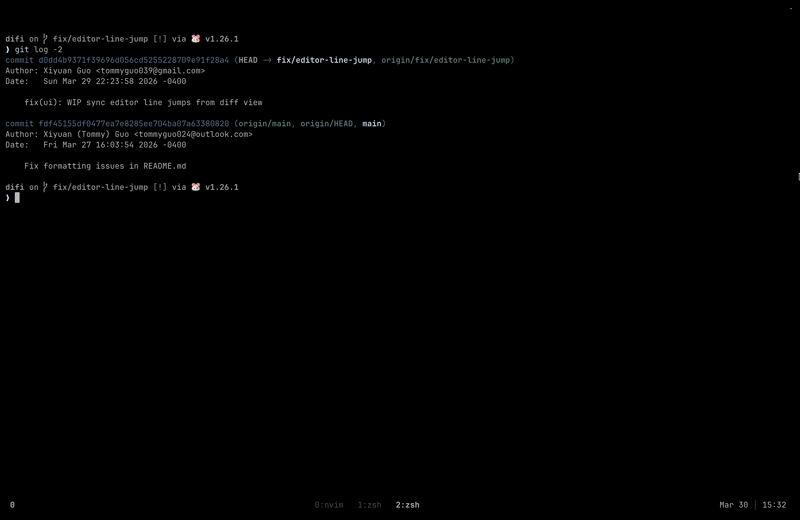

<p align="center">
  
</p>

<p align="center">
  <b>Review and refine Git diffs before you push.</b>
</p>

<p align="center">
  <a href="https://difi.vercel.app/">
    
  </a>
  
  
  
</p>

<p align="center">
    
</p>


## Installation

#### Homebrew (macOS & Linux)

```bash
brew install difi
```

#### Go Install

```bash
go install github.com/xguot/difi/cmd/difi@latest
```

#### AUR (Arch Linux)

**Binary (pre-built):**

```bash
pikaur -S difi-bin
```

**Build from source:**

```bash
pikaur -S difi
```

#### Manual (Linux / Windows)

- Download the binary from Releases and add it to your `$PATH`.

## Workflow

Run difi in any Git repository against HEAD:

```bash
cd my-project
difi
```

To compare against a specific branch or commit, just pass it as an argument:

```bash
# Compare against the main branch
difi main

# Compare against the previous commit
difi HEAD~1
```

## Choose What to Review

The default remains working files compared with `HEAD`, including untracked files.
Use these flags to narrow the review:

| Command | Comparison | Untracked files |
| --- | --- | --- |
| `difi` | Working tree against `HEAD` | Included |
| `difi --staged` / `difi -s` | Git index against `HEAD` | Excluded |
| `difi --staged main` | Git index against `main` | Excluded |
| `difi --unstaged` / `difi -u` | Working tree against the Git index | Included |
| `difi --no-untracked` | Default comparison, tracked files only | Excluded |
| `difi -u --no-untracked` | Unstaged changes to tracked files | Excluded |

Put flags before the optional target. `--staged` and `--unstaged` are Git-only
and cannot be combined. `--unstaged` takes no target. `--no-untracked` also
works with Mercurial. Staged reviews work before the first commit.

The header identifies the comparison. Editing a file and using `:w` refreshes
the same scope. The editor always opens the working file; in staged mode,
editing does not stage the result. Difi does not stage or discard changes.

Add `--plain` / `-p` to print file paths without opening the UI:

```bash
difi --plain --staged
difi --plain --unstaged --no-untracked
```

## Piping & Alternative VCS

You can also pass raw diffs directly into `difi` via standard input. This is perfect for patch files or other version control systems like Jujutsu:

```bash
# Review a saved patch file
difi < changes.patch

# Review changes in Jujutsu (jj)
jj diff --git | difi

# Pipe standard git diff output
git diff | difi
```

For a headless list of the files in a patch:

```bash
git diff --cached | difi --plain
```

A piped patch defines its own comparison. Scope flags and positional targets
cannot be combined with stdin. Refresh re-reads the supplied patch in memory;
use a native scope such as `difi -u` to refresh changes from disk. An empty patch
stays empty instead of falling back to the current repository.

## Controls

| Key           | Action                                       |
| ------------- | -------------------------------------------- |
| `Tab`         | Toggle focus between File Tree and Diff View |
| `j / k`       | Move cursor down / up                        |
| `h / l`       | Focus Left (Tree) / Focus Right (Diff)       |
| `e` / `Enter` | Edit file (opens editor at selected line)    |
| `/` | Filter files in the tree; search text in the diff |
| `n` / `N` | Next / previous matching diff line (wraps) |
| `]c` / `[c` | Next / previous hunk (`}` / `{` also work) |
| `Esc` | Cancel input, or clear the focused pane’s filter/search |
| `:`           | Open vim-style command line                  |
| `?`           | Toggle help drawer                           |
| `q` / `ZZ`    | Quit                                         |

## Find Files and Changes

In the file tree, press `/` and type part of a path. Matching is literal and
case insensitive, including directory names. Results show full paths, including
files in collapsed folders. `Enter` keeps the filter; `Esc` during input restores
the previous filter and selection. Press `Esc` in the tree to clear an applied
filter. Filters survive refreshes.

In the diff pane, press `/` to search the selected file’s diff. Matching lines
are underlined and marked with `◆`; `n` and `N` move forward and backward,
wrapping at the ends. The footer shows matching-line counts. Search is literal
and case insensitive; hunk headers are excluded. `Esc` cancels input or clears
the applied search; `:noh` also clears it. Use `Ctrl-u` to clear prompt input.

Use `]c` / `[c` (or `}` / `{`) to move between the first changed lines of hunks.
Hunk navigation stops at the first and last hunk. Vim counts work, such as
`3]c` or `5n`. In terminals narrower than 60 columns, the focused pane fills the
screen; use `Tab` or `h` / `l` to switch panes.

Git editor sessions export `DIFI_SCOPE` as `working`, `staged`, or `unstaged`.
`DIFI_TARGET` contains the target ref; it is empty for the index baseline in
unstaged mode. Staged line positions are mapped through unstaged edits before
the working file is opened.

## Configuration

`difi` can be configured using a YAML file located at `~/.config/difi/config.yaml`. If the file doesn't exist, `difi` will use sensible defaults.

### Example `config.yaml`

```yaml
editor: "nvim"

ui:
  line_numbers: "hybrid"
  theme: "nord"
  diff_add_bg: "#2b3328" # Optional: Custom background for added lines
  diff_del_bg: "#4a2323" # Optional: Custom background for deleted lines
```

### Options

| Key               | Default                                       | Description                                              |
| :---------------- | :-------------------------------------------- | :------------------------------------------------------- |
| `editor`          | `$DIFI_EDITOR`, `$EDITOR`, `$VISUAL`, or `vi` | The editor to open when pressing `e` on a file.          |
| `ui.line_numbers` | `"hybrid"`                                    | The style of line numbers in the diff view.              |
| `ui.theme`        | `"nord"`                                      | The vim colorscheme used for syntax highlighting and UI. |
| `ui.diff_add_bg`  | `""`                                          | Hex code or terminal color for added line backgrounds.   |
| `ui.diff_del_bg`  | `""`                                          | Hex code or terminal color for deleted line backgrounds. |

## Command Line

Press `:` to open a vim-style command line at the bottom of the screen. Available commands:

| Command                    | Action                                      |
| -------------------------- | ------------------------------------------- |
| `:colorscheme <name>`      | Switch to a different theme                 |
| `:theme <name>`            | Alias for `:colorscheme`                    |
| `:set <option>`            | Change a setting live (e.g. `:set number`)  |
| `:w`, `:write`             | Refresh files, statistics, and diff          |
| `:help`, `:h`              | Toggle the help drawer                      |
| `:noh`, `:nohlsearch` | Clear search and visual selection |
| `:<number>`                | Jump to line N in the diff                  |
| `:$`                       | Jump to last line in the diff               |
| `:q`, `:quit`              | Exit (same as pressing `q` in normal mode)  |

Tab cycles through matching commands, theme names, and `:set` options. Press `Esc` to cancel.

### `:set` Options

| Option                  | Effect                          |
| ----------------------- | ------------------------------- |
| `number` / `nu`         | Absolute line numbers           |
| `nonumber` / `nonu`     | Hide line numbers               |
| `relativenumber` / `rnu`| Relative line numbers           |
| `norelativenumber`      | Disable relative line numbers   |
| `hybrid`                | Hybrid (absolute on cursor)     |
| `relative`              | Relative mode                   |
| `absolute`              | Absolute mode                   |
| `hidden`                | No line numbers                 |

### Available Themes

| Theme               | Description        |
| ------------------- | ------------------ |
| `nord` *(default)*  | Nord dark          |
| `gruvbox`           | Gruvbox dark       |
| `catppuccin-mocha`  | Catppuccin Mocha   |
| `catppuccin-latte`  | Catppuccin Latte   |
| `dracula`           | Dracula            |
| `monokai`           | Monokai            |
| `onedark`           | OneDark            |
| `github`            | GitHub Light       |
| `github-dark`       | GitHub Dark        |
| `rose-pine`         | Rosé Pine          |
| `rose-pine-dawn`    | Rosé Pine Dawn     |
| `solarized-dark`    | Solarized Dark     |
| `tokyonight-night`  | Tokyo Night        |
| `tokyonight-storm`  | Tokyo Night Storm  |
| `evergarden`        | Evergarden         |
| `doom-one`          | Doom One           |
| `quiet`             | Quiet (minimal)    |

Set a default theme in `~/.config/difi/config.yaml`:

```yaml
ui:
  theme: "dracula"
```

## Integrations

#### vim-fugitive

- **The "Unix philosophy" approach:** Uses the industry-standard Git wrapper to provide a robust, side-by-side editing experience.
- **Side-by-Side Editing:** Instantly opens a vertical split (:Gvdiffsplit!) against the index.
- **Merge Conflicts:** Automatically detects conflicts and opens a 3-way merge view for resolution.
- **Config**: Add the line below to if using **lazy.nvim**.

```lua
{
  "tpope/vim-fugitive",
  cmd = { "Gvdiffsplit", "Git" }, -- Add this line
}
```

<p align="left"> 
  <a href="https://github.com/tpope/vim-fugitive.git">
    
  </a>
</p>

#### difi.nvim

Get the ultimate review experience with **[difi.nvim](https://github.com/xguot/difi.nvim)**.

- **Auto-Open:** Instantly jumps to the file and line when you press `e` in the CLI.
- **Visual Diff:** Renders diffs inline with familiar green/red highlights—just like reviewing a PR on GitHub.
- **Interactive Review:** Restore a "deleted" line by simply removing the `-` marker. Discard an added line by deleting it entirely.
- **Context Aware:** Automatically syncs with your `difi` session target.

<p align="left">
  <a href="https://github.com/xguot/difi.nvim">
    
  </a>
</p>

## Git Integration

To use `difi` as a native git command (e.g., `git difi`), add it as an alias in your global git config:

```bash
git config --global alias.difi '!difi'
```

Now you can run it directly from git:

```bash
git difi
```

## Contributors

- [Abraham Joy (@abraham-1672)](https://github.com/abraham-1672) - Logo and Wordmark Design

## Star History

<a href="https://star-history.com/#xguot/difi&Date">
    <picture>
      <source media="(prefers-color-scheme: dark)" srcset="https://api.star-history.com/svg?repos=xguot/difi&type=Date&theme=dark" />
      <source media="(prefers-color-scheme: light)" srcset="https://api.star-history.com/svg?repos=xguot/difi&type=Date" />
      
    </picture>
  </a>
</div>
